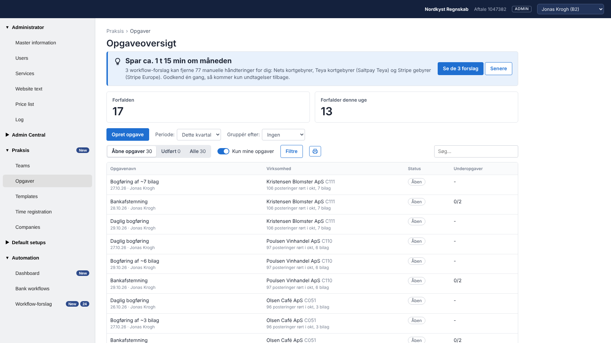
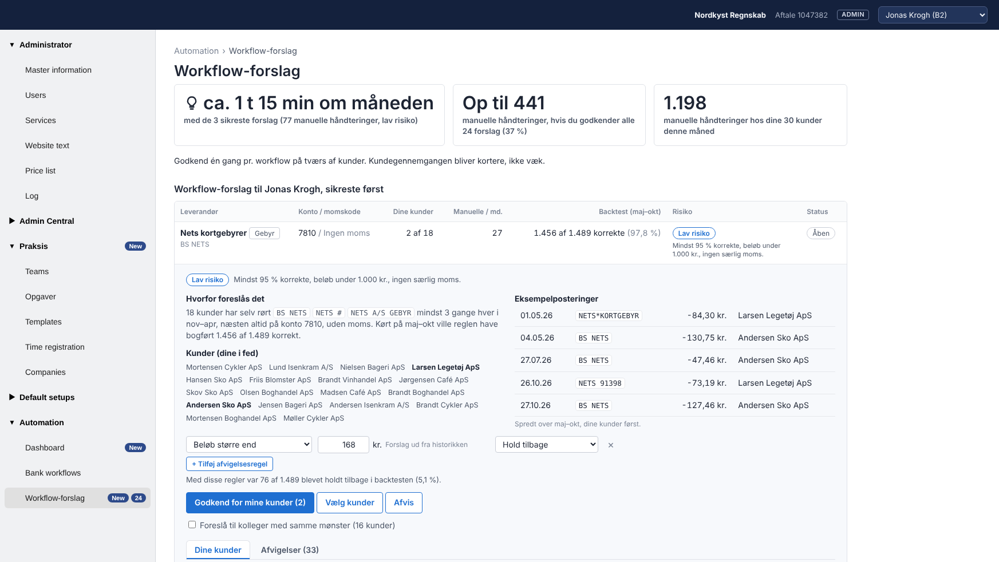
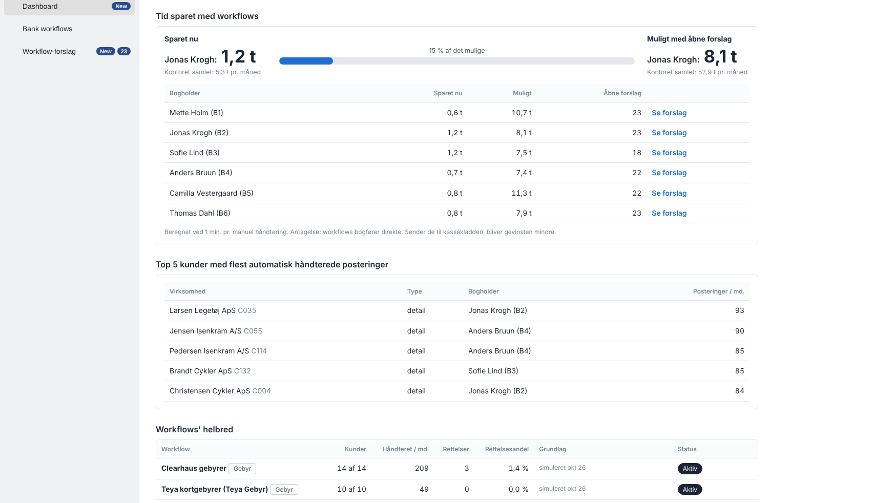
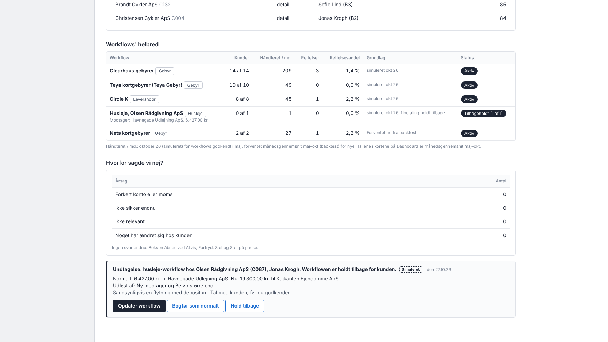

# Workflow suggestions across clients

**A product case I took from problem to working prototype on my own, building with AI at every step.** I made it for Visma e-conomic in November 2026.

[Deck (PDF)](deck/e-conomic-case-workflow-suggestions.pdf) · [Prototype](prototype/index.html) · [How I used AI](#how-i-used-ai) · [Reproduce it](#repo-layout-and-how-to-reproduce)

## What this shows

- **Finding the right problem before building.** The brief came with a paradox: *67 % of entries are automated "to some degree", yet hours per client are unchanged.* I tested three explanations against a trial account, the product documentation and an interview with an accountant, and chose the one the evidence supported.
- **Turning an idea into a testable bet.** I tied one metric to the brief's north star and planned three learning loops. Each loop has a kill criterion that I set before I had any data.
- **Building with AI end to end.** I made a synthetic accounting office with about 100,000 postings, pattern detection with an out-of-sample backtest, an evaluation of AI grouping against rule-based grouping, a clickable prototype with a 266-check self-test, and the deck. All of it rebuilds from one command.
- **Judgement over output.** I document where AI was confidently wrong and what I changed. My assumptions are conservative, even where that put the result right on my own kill line, and I didn't tune the data to pass.
- **Learning a new domain fast.** The case deals with bookkeeping workflows and the details that decide whether an automation is safe: VAT on fuel, card payouts net of fees, deposits when a client moves.

## Context

The brief was *"Managing a client portfolio in an AI world"*:

> 67 % of entries from bank transactions and documents are automated *to some degree*, yet hours per client are unchanged after three months. (from the case brief)

**Everything in here is synthetic.** The accounting office "Nordkyst Regnskab", its 180 clients, 6 bookkeepers and every posting are generated with a fixed seed. Nothing is measured from a real office or from e-conomic's product. This is independent work for an interview. Visma e-conomic has not made, reviewed or endorsed it. The prototype's menu mirrors how e-conomic presents its Praksis module publicly, so that the demo would feel familiar to the panel.



## The problem

My reading of "to some degree": the system proposes how to post an entry, but a bookkeeper still checks and posts it. The manual handling stays, so the hours stay.

I looked at three explanations:

1. **Monitoring eats the freed time.** This is the closest fit to the brief, but I found no evidence from users.
2. **Missing documents and bank data.** This is real for the accountant I interviewed, but it explains less of the flat hours for offices that already use automation.
3. **Nothing proposes the automation.** The evidence pointed here:
   - In my trial account, bank workflows sit behind an icon with a generic tooltip.
   - e-copedia shows that you can create a workflow from one payment, but the user has to start it. I found nothing that notices the same entry repeating across clients.
   - The accountant I interviewed uses no workflows and asked for *"automatically generated suggestions for automations"*.

**Hypothesis:** rules would be created more often if they were actually suggested.

## The idea

Managing a portfolio moves from client by client to **pattern by pattern**. The system finds an entry that repeats across clients, replays it on months it wasn't found in (a backtest), and suggests a workflow only if it would have been right at least 95 % of the time. The bookkeeper approves once, for his own clients. After that, only exceptions come back.

- **Nudge where the work happens.** A suggestion appears on the bookkeeper's task overview in Praksis, with the time it would save. At Skatteguiden, a feature only took off once we deep-linked users straight into it.
- **Evidence before yes.** Every suggestion shows its backtest, its deviations and why it is low or medium risk.
- **Control after yes.** The bookkeeper decides for his own clients only. He can add deviation rules (amount above or below a limit suggested from history, new payee, VAT code differs), and he can undo, pause or delete. Every no asks why.
- **Exception path.** When a fixed recurring entry changes, such as rent going to a new landlord, the workflow holds it for that one client. The system sees *what* changed, not *why*. The bookkeeper decides.



## The prototype

`prototype/index.html` is a single self-contained file, so you can open it in any browser. You are Jonas Krogh, a fictional bookkeeper with 30 clients. The demo path in the interview took about 3.5 minutes:

1. **Opgaver:** the nudge says three suggestions would save about 1 hour 15 minutes a month. Click *Se de 3 forslag*.
2. **Workflow-forslag:** the safest suggestions come first. Nets card fees show 18 clients (2 of them Jonas'), with 1,456 of 1,489 correct in the backtest.
3. **Deviation rule and approve:** add *Beløb større end*. The system suggests 168 kr. from history, which would have held back 5.1 % of entries. Then approve for my clients (2), with a 10-second undo.
4. **No with a reason:** dismiss a suggestion and choose *Ikke sikker endnu* (not sure yet).
5. **Bank workflows:** the created workflow, with its rule, plus pause and delete.
6. **Dashboard:** time saved now and possible, for Jonas and for the office.
7. **Hvorfor sagde vi nej?** The reasons behind every no.
8. **Exception:** rent at one client jumps from 6,427 to 19,300 kr. to a new landlord. Jonas' rules hold it.

The page content is in Danish, like e-conomic. Reloading the page resets everything. Open `prototype/index.html#selftest` to run the built-in click test (266 checks).




## How I'd know if I'm right

**Metric:** manual handlings per client, converted into hours saved per office per month, which is the brief's north star. Adoption is a leading indicator, not the outcome.

| Loop | Question | Kill criterion |
|---|---|---|
| 1 · existing data, no build | How many manual handlings could workflow suggestions remove? | Under 2 hours per bookkeeper a month, at 1 minute per manual handling |
| 2 · 5 bookkeepers, own clients | Do they approve, and why do they say no? One week of timing, then four weeks with suggestions. | Under 20 % approved, and most dismissals say "wrong". If most say "not sure", I improve the suggestions instead. |
| 3 · pilot with a control group | Do manual handlings per client fall? | They fall less than 5 % more than in the control group, even though workflows are approved |

I set the thresholds before I had any data. I used 1 minute per manual handling even though it put the safe start right on my own kill line, and I didn't tune the data to pass.

## What it takes to pay off (synthetic office)

- 2 hours per bookkeeper a month means removing **120 manual handlings** at 1 minute each.
- The synthetic office has about **250 repeating manual handlings** per bookkeeper a month (246.7), so **49 %** of them must be approved. At 500 repeating handlings the figure would be 24 %, and at 1,000 it would be 12 %.
- At 50 % approval: **2.1 hours** per bookkeeper and **12 hours** per office a month. The ceiling, with every suggestion approved, is 8.8 hours and 53 hours.
- **112** patterns were found. 94 were suggested (16 low risk, 78 medium risk) and 18 were not.
- **51 %** of manual handlings are out of reach: the long tail of payments (38 %) and special VAT (13 %).

The real question is how much actually repeats at real clients. Loop 1 counts that.

## How I used AI

| | Delegated | What came back | What I changed |
|---|---|---|---|
| Finding the problem | Research, the product's AI assistant, challenges to my hypothesis | Answers built on my leading words, and claims the brief doesn't support | Checked the sources myself and let a real interview choose the problem |
| Data and analysis | Synthetic data, grouping, sizing | Numbers that looked better than they were. The first sizing let the test see its own months and said 48 %. | An honest out-of-sample test and assumptions I can defend, even on my own kill line |
| The prototype | A clickable prototype | Generic, and it assumed the bookkeeper would just say yes | The bookkeeper in control: own clients, undo, a reason for every no |
| The story | Slides and wording | Too much text, the wrong product terms, examples that don't fit small businesses | Fewer slides, e-conomic's own terms, real changes at small businesses |

AI also did the one job where it beats simple rules: **grouping messy bank texts**. Nets alone appears in five text forms. On the synthetic texts, AI grouping made no dangerous merges, while rule-based grouping merged Google Ads with Google Workspace (`eval/grouping_eval.json`).

## Repo layout and how to reproduce

```
generate_postings.py   synthetic postings, fixed seed 42        -> data/postings.csv
grouping.py            rule-based vs AI grouping of bank texts   -> eval/
analyze_patterns.py    patterns, backtest, sizing, value         -> output/
key_numbers.py         the numbers behind the deck               -> output/key_numbers.md
build_prototype.py     template + data                           -> prototype/index.html
prototype/             index.html (the demo), template.html
deck/                  the deck as .pptx (speaker notes = script) and .pdf
docs/screenshots/      screens from the prototype
```

```bash
pip install pandas
python generate_postings.py && python grouping.py && python analyze_patterns.py && python key_numbers.py && python build_prototype.py
```

The pipeline rebuilds `prototype/index.html` and `output/` byte for byte, apart from line endings. `grouping.py` uses the cached AI mapping in `eval/ai_mapping.json`. `--refresh` calls `claude -p` again. The large generated files (`data/postings.csv`, `output/backtest_postings.csv`, `output/patterns.json`) are not committed. The first command recreates them.

## Assumptions and known issues

- **Approved workflows post without a human.** Today, bank workflows send entries to the Kassekladde (draft journal). If that doesn't change, the gain shrinks to posting the whole Kassekladde at once.
- **Every client has a bank connection.** Workflows only run automatically with a bank integration, so clients on CSV imports gain less.
- **The exception is simulated.** I inserted one rent payment into the data. It is not detected from the data.
- **Card settlements show up as medium-risk suggestions.** A card payout is net of fees, so it should be reconciled, not posted as revenue. They are excluded from expected savings but included in the ceiling.
- **Dismissals apply office-wide.** In the prototype, a no removes the suggestion for every bookkeeper, while pause and delete only affect your own clients. I'd split this: "wrong" stops it for everyone, "not sure yet" only for you.
- **Deviations are built-in noise.** The generator puts about 3 % on a neighbouring account on purpose, so deviation numbers reflect the generator, not real bookkeepers.
- **The user evidence is one interview,** with one office I have a personal connection to. Loop 2 exists to fix that.

**Thomas Christian Vang** · Product lead with a background in tax (Skatteguiden) and data (Ørsted) · November 2026
